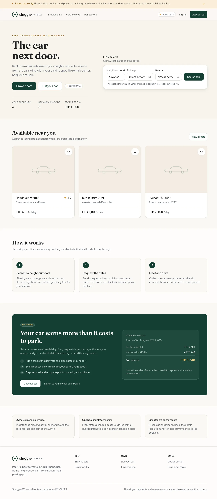
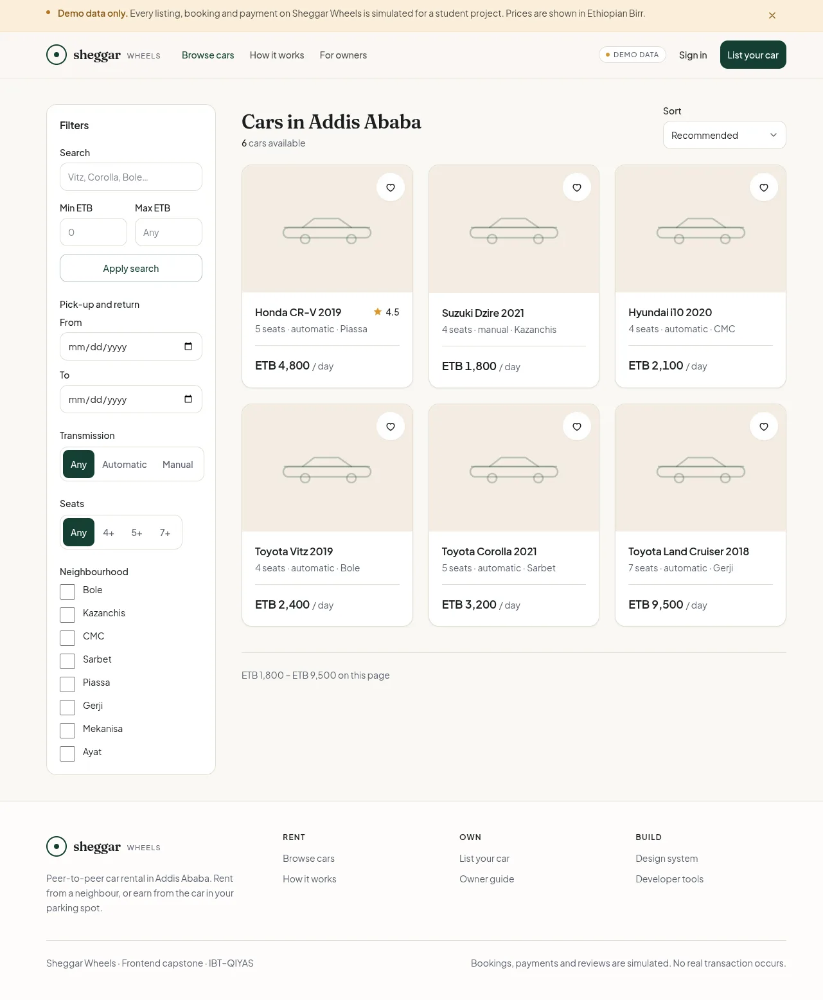
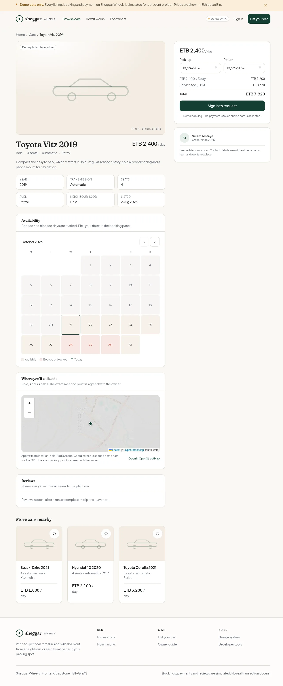
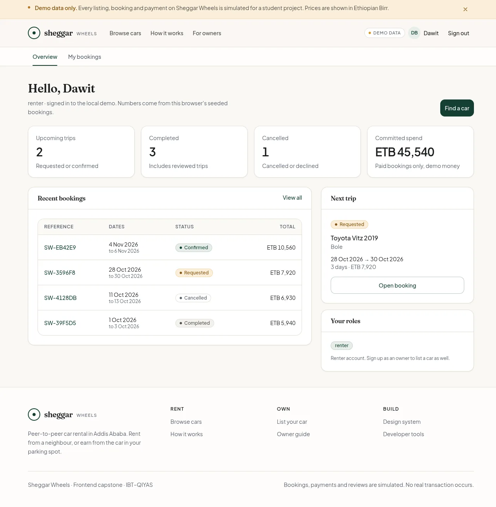
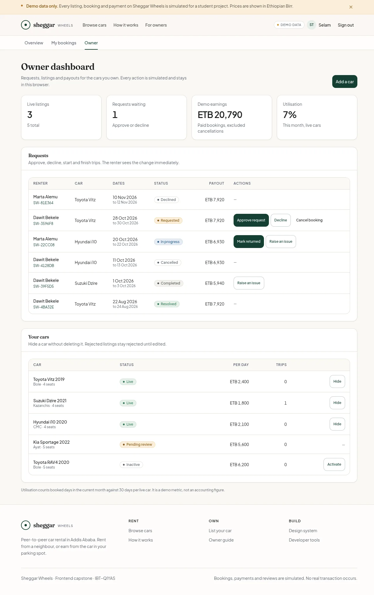
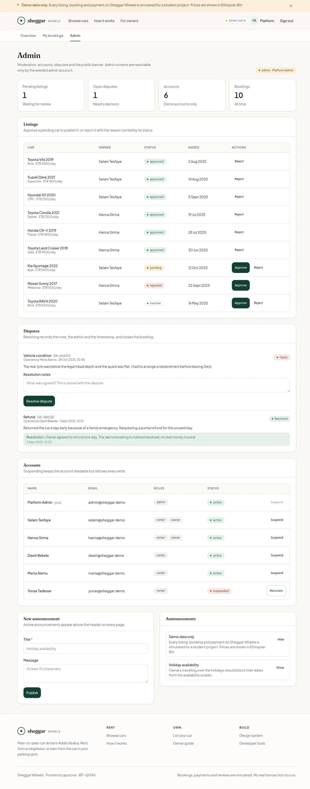

# Sheggar Wheels

A peer-to-peer car rental marketplace for Addis Ababa. Car owners list idle
vehicles, renters book them by the day, and admins moderate the platform.

**This is a student capstone demo.** There is no database, no real authentication
and no real payment. All records live in the browser and every simulated feature
is labelled as such.

---

## Status

| Layer | State |
|---|---|
| Next.js 16 App Router, JavaScript + JSDoc | ✅ |
| Tailwind v4 design tokens + UI kit + `/styleguide` | ✅ |
| Seed data, versioned storage, corrupt-key recovery | ✅ |
| Session, roles, booking state machine, permissions | ✅ |
| Landing, catalogue, car detail, auth | ✅ |
| Checkout, receipt, renter dashboard, bookings + CSV | ✅ |
| Owner dashboard: requests, listings, add a car | ✅ |
| Admin: moderation, accounts, disputes, announcements | ✅ |
| Metadata, JSON-LD, sitemap, robots | ✅ |
| Tests (88) + `/dev` misuse checks (6/6) | ✅ |
| Lighthouse: a11y 100, best practices 100, SEO 100 | ✅ |

## Screenshots

Seeded demo data, desktop 1280 px.

| Landing | Catalogue |
| --- | --- |
|  |  |

| Car detail | Renter dashboard |
| --- | --- |
|  |  |

| Owner dashboard | Admin |
| --- | --- |
|  |  |

## Routes

| Route | Purpose |
|---|---|
| `/` | Landing: hero search, featured cars, how it works, owner pitch |
| `/cars` | Catalogue. Every filter lives in the URL |
| `/cars/[id]` | Detail: specs, availability calendar, map, reviews, booking panel |
| `/signin` | Demo account picker or email lookup, honours `?next=` |
| `/signup` | Creates a local account, optionally with owner tools |
| `/checkout` | Mock TeleBirr payment for the booking in the checkout draft |
| `/bookings` | The signed-in renter's bookings, with status and CSV export |
| `/bookings/[id]` | Receipt: timeline, payment, allowed actions, review, dispute |
| `/dashboard` | Renter overview: upcoming trips, spend, recent bookings |
| `/owner` | Owner overview: requests, earnings, utilisation, cars, add a car |
| `/admin` | Moderation queue, accounts, disputes, announcements |
| `/dev` | Data inspector + six misuse checks (internal) |
| `/styleguide` | Component reference (internal) |
| `/sitemap.xml`, `/robots.txt` | Public routes and approved cars only |

Private routes are `noindex`, disallowed in `robots.txt`, and render on request
(`instant = false`) because the server cannot read the session.

## Getting started

```bash
npm install
npm run dev
```

Open <http://localhost:3000>. If port 3000 is taken, Next prints the port it
actually used.

```bash
npm run build   # production build
npm run start   # serve the build
npx eslint .    # lint
npm test        # domain + query tests (Vitest)
```

No environment variables are required. Copy `.env.example` to `.env.local` only
to set `NEXT_PUBLIC_SITE_URL` for a deployment. This capstone is not hosted; the
screenshots were captured locally from the production build.

## Demo accounts

Sign-in is an account switcher: no password, no email. Choose one of these on
`/signin`.

| Account | Roles | What it shows |
|---|---|---|
| Dawit Bekele | renter | Bookings in every lifecycle state, reviews, payment |
| Selam Tesfaye | renter, owner | 5 listings (3 live, 1 pending, 1 inactive), requests |
| Hanna Girma | renter, owner | 3 listings, an open dispute |
| Platform Admin | admin | Moderation queue, accounts, disputes, announcements |
| Yonas Tadesse | renter (suspended) | The blocked-state panel and refused writes |

New accounts created on `/signup` are stored in this browser only and can opt
into owner tools. The admin role can never be self-assigned.

### A five-minute walkthrough

1. Sign in as **Dawit** → `/cars` → pick a car → choose dates → **Request to
   book**. The mock TeleBirr checkout opens; pay and open the receipt.
2. Sign out, sign in as **Selam** → `/owner` → approve Dawit's request → **Start
   rental** → **Mark returned**.
3. Sign in as **Dawit** → `/bookings` → open the completed trip → leave a review.
4. Sign in as **Selam** → `/owner` → open that booking → publish one owner reply.
5. Sign in as **Admin** → `/admin` → approve the pending Kia, resolve a dispute,
   post an announcement.
6. Sign in as **Yonas** → `/dashboard` to see the suspended state.

Reset the data at any time from `/dev`.

## Tech stack

- **Next.js 16** — App Router, server components for static shells, metadata and
  PPR on the car detail route
- **React 19** — `useSyncExternalStore` for the store and hydration gates
- **Tailwind CSS v4** — CSS-first tokens in `app/globals.css` (`@theme`), no
  config file
- **next/font** — self-hosted Fraunces + Plus Jakarta Sans
- **Leaflet** — seeded coordinates on OpenStreetMap tiles, client-only and
  dynamically imported
- **JavaScript + JSDoc** — `@typedef` for the data model, no TypeScript build step

## Project structure

```
app/
  layout.js              root layout, fonts, skip link, metadata
  (public)/
    layout.js            shared chrome: announcement bar, header, main, footer
    page.js              landing
    cars/page.js         catalogue shell
    cars/[id]/page.js    metadata + JSON-LD, then the client island
    signin/page.js       demo sign-in
    signup/page.js       demo sign-up
  (app)/
    layout.js            same chrome for the signed-in area
    checkout/            mock payment
    bookings/            list + receipt
    dashboard/           renter overview
    owner/               owner overview, requests, cars, add a car
    admin/               moderation, accounts, disputes, announcements
  dev/                   data inspector + misuse checks
  styleguide/            living component reference
  sitemap.js, robots.js  SEO routes
components/
  site/                  header, footer, announcement bar, hero search, featured cars
  cars/                  catalogue client, detail client, calendar, map
  auth/                  sign-in, sign-up, RequireRole guard
  app/                   dashboard nav, page header
  bookings/              bookings list, receipt, review/dispute forms
  checkout/              mock TeleBirr checkout
  dashboard/             renter overview
  owner/                 owner dashboard and car form
  admin/                 moderation, accounts, disputes, announcements
  ui/                    Button, Badge, Card, Field, Table, EmptyState,
                         Skeleton, Pagination, StatCard, Segmented
  car/CarCard.js         the signature catalogue card
lib/
  storage.js             safe read/write, seeding, reset, recovery
  store.js               snapshot + subscribe (useSyncExternalStore)
  session.js             demo session, roles, safeReturnPath
  booking-state.js       the lifecycle table and its guards
  permissions.js         can(user, action, resource)
  pricing.js             days, overlap, fees
  dates.js               strict ISO date helpers
  cars-query.js          URL parsing, filtering, sorting, pagination
  site.js                canonical origin for metadata and sitemap
  use-hydrated.js        client-only rendering gate
  use-today.js           "today" without baking the build date into HTML
  seed/                  demo users, 9 cars, 10 bookings, reviews, disputes
  domain/                cars, bookings, users, reviews, disputes, announcements
tests/                   88 Vitest checks over the pure + domain + query layers
```

## Data layer

Keys are versioned so a shape change can ship alongside old browsers:

| Key | Contents |
|---|---|
| `sw_users_v1` | demo accounts, roles, status |
| `sw_cars_v1` | listings and moderation status |
| `sw_bookings_v1` | bookings and lifecycle status |
| `sw_reviews_v1` | reviews and owner replies |
| `sw_disputes_v1` | disputes and resolutions |
| `sw_announcements_v1` | platform announcements |
| `sw_meta_v1` | seed version |
| `sw_session_v1` (sessionStorage) | signed-in demo user id only |
| `sw_checkout_draft_v1` (sessionStorage) | in-progress checkout |

Seeding runs once and only fills keys that are missing or unreadable — it never
overwrites existing records. Unreadable keys are repaired and reported through
`getStorageReport()` rather than crashing the app; the snapshot exposes them as
`storage.recoveredKeys`.

Every mutation goes through a domain function that re-checks session, role,
ownership and current state before writing. UI checks are a convenience; the
guards in `lib/` are the ones that matter.

## The booking lifecycle

```
requested → confirmed → in_progress → completed → reviewed
     │           │
     └ declined  └ cancelled
                 in_progress/completed → disputed → resolved
```

`transitionBooking()` is the only writer of `booking.status`. It distinguishes
`NOT_YOURS` (right role, wrong person) from `FORBIDDEN` (wrong role), and the
receipt, owner queue and admin views all render their buttons from
`allowedActions()` — one table, one guard, no drift.

## Catalogue URLs

The catalogue has no client-side filter state of its own. The URL is the state:

```
/cars?q=vitz&neighbourhood=Bole,CMC&min=2000&max=6000&transmission=automatic&seats=4&from=2026-11-01&to=2026-11-03&sort=price-asc&page=2
```

`lib/cars-query.js` parses those params defensively — unknown neighbourhoods,
negative prices, impossible dates and junk sorts are dropped, never thrown.
Changing any filter clears `page`; out-of-range pages clamp to the last page.
That keeps results shareable, the back button honest and the empty state
reachable.

Dates are checked against both `unavailableDates` and active bookings, so a
"free" result is actually free.

## Security behaviour worth knowing

- **`?next=` is sanitised.** `safeReturnPath()` accepts only same-origin paths,
  so `?next=https://example.com`, `//evil.example` and `/\evil.example` resolve
  to the dashboard.
- **Writes are guarded in the domain layer.** A signed-out request returns
  `NOT_SIGNED_IN`; another user's booking returns `NOT_YOURS`; a suspended
  account returns `SUSPENDED`. The three required negative tests run in `/dev`.
- **CSV export resists formula injection.** Leading `=`, `+`, `-` and `@` are
  prefixed with `'` so a spreadsheet treats them as text.
- **JSON-LD escapes `<`** so seeded text cannot close the script tag.
- **The demo does not pretend to be secure.** Roles live in `localStorage` and
  can be edited. See `AUTH.md` and `BOUNDARY.md`.

## Demo behaviour worth knowing

- **Sign-in is a user-id switch.** No password, token or cookie. The session
  lives in `sessionStorage` and ends when the tab closes.
- **The booking panel refuses before it writes.** Signed out, it redirects to
  `/signin?next=…`; owners see "this is your listing"; date conflicts disable
  the button and explain why.
- **The detail island is client-rendered.** Metadata and JSON-LD are server
  rendered from the seed, while prices and reviews come from the visitor's
  storage. A skeleton holds the layout until hydration.
- **Payment is a simulation.** The TeleBirr panel says so, takes no card data,
  writes a `DEMO-TB-…` reference and `paymentStatus: "paid"`, and never contacts
  a provider.
- **The map needs network.** Tiles come from OpenStreetMap; the seeded
  neighbourhood and an "Open in OpenStreetMap" link are the text fallback.
- **Cars with no photo use generated artwork.** Every seeded listing has
  `photos: []`, so the card and detail page draw the car glyph instead of
  requesting a missing image.

## Design system

| Token | Value | Use |
|---|---|---|
| `--color-ink` | `#14181A` | Primary text |
| `--color-forest` | `#0B3D2E` | Primary action |
| `--color-ochre` | `#D99A2B` | Prices, pending states |
| `--color-ochre-ink` | `#8A5A12` | Small gold text on light surfaces (contrast) |
| `--color-sand` | `#F3EDE3` | Section bands, chips |
| `--color-canvas` | `#FAF8F4` | Page background |
| `--color-line` | `#E4DED2` | Borders |
| `--radius-card` | `16px` | Cards |
| `--radius-btn` | `12px` | Buttons and inputs |

Conventions enforced in the kit:

- Buttons, inputs and other standalone controls are at least 44 px tall.
  Inline and footer text links keep their natural line height.
- Focus rings are always visible (`:focus-visible`, 2 px forest, 2 px offset).
- Booking status is always a written label, never colour alone.
- Inputs have a label above, helper text below, and wired `aria-invalid` /
  `aria-describedby` on error.
- Prices use tabular figures (`data-numeric`) so columns don't jitter.
- Text passes 4.5:1 contrast; the brand gold is only used for large text or on
  dark panels, with `--color-ochre-ink` for small text on light surfaces.

## Documentation

- [`STRATEGY.md`](./STRATEGY.md) — problem, personas, scope, route-by-route
  rendering table, risks
- [`AUTH.md`](./AUTH.md) — demo auth model, role matrix, the three negative tests
- [`DATA.md`](./DATA.md) — keys, shapes, lifecycle, write path, recovery
- [`BOUNDARY.md`](./BOUNDARY.md) — trust boundaries, validation layers, injection
- [`PERF.md`](./PERF.md) — measured production numbers, budgets, caveats
- [`FUTURE.md`](./FUTURE.md) — what a real build needs, phase by phase
- [`CHECKLIST.md`](./CHECKLIST.md) — the 43 course concepts mapped to files and evidence
- [`PLAN.md`](./PLAN.md) — decisions, folder structure, day-by-day tasks
- [`DESIGN_PROMPTS.md`](./DESIGN_PROMPTS.md) — Google Stitch prompts for the UI
  exploration

## Known limitations

- **Everything is per browser.** Clearing site data resets the demo; another
  browser is another database. `/dev` can reseed without clearing.
- **Roles and ownership are client-side.** `localStorage` can be edited; the
  guards stop accidents and honest mistakes, not an attacker with DevTools.
- **Two tabs can race the overlap check.** Availability is checked before a
  write, not locked across tabs.
- **The map is approximate.** Coordinates are seeded, not a verified pick-up
  point.
- **No uploads, messaging, email or push.** Listings use generated artwork; the
  receipt and status history carry the communication.
- **The detail content is client-rendered.** Only its metadata, JSON-LD and the
  static shell are in the initial HTML.
- **No analytics or error reporting.** The success metrics in `STRATEGY.md` are
  what a real build would instrument first.
